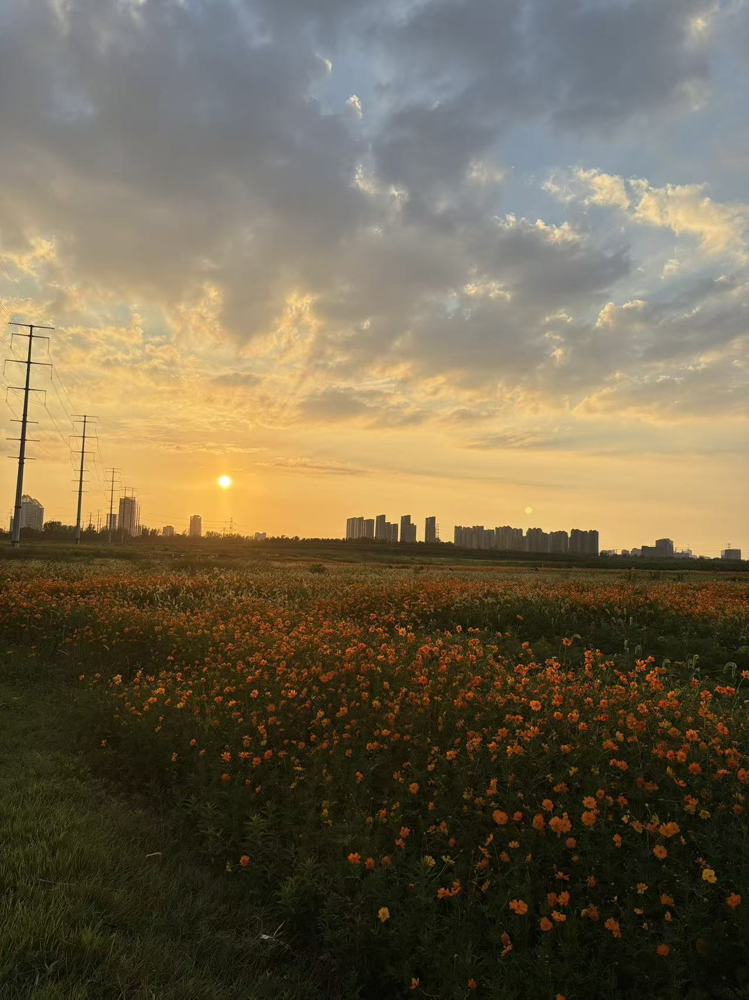
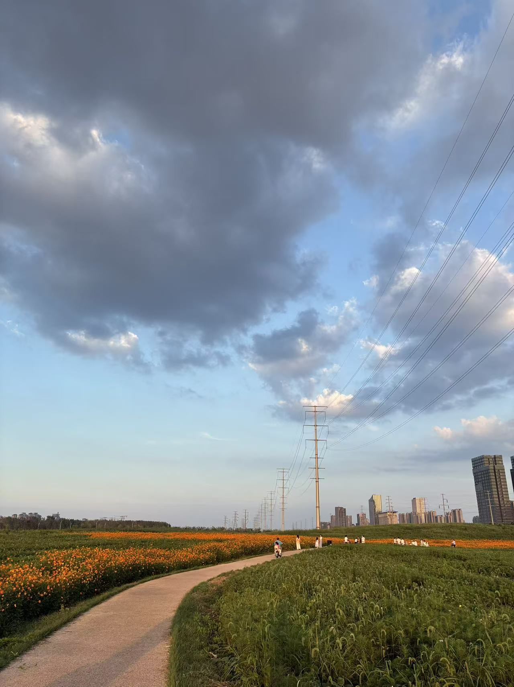
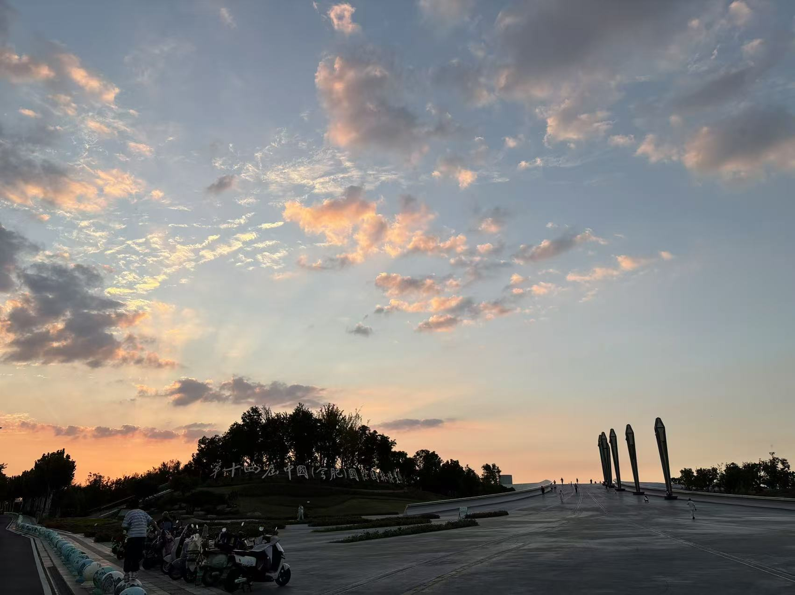

今年进入到“秋高气爽”的时节似乎比去年早了1个月，清楚的记得去年在小红书记录的降温转凉的日子是9月20多号，而今年的8月底（25+），随着台风到来，就一直都转凉了，湿度也降了下来，我查看了接下来一个礼拜的天气，都是30摄氏度以内，连秋老虎都没了；

昨天周六，把停了N久的车子开出去溜了溜。周末，巢湖周边，公园，草坪，加上如今的好天气，到处都是人，马路边到处都是停的车，大家都出来了；看到这般景象，我有点小吃惊，我本就不喜欢人多的地方吧。而自己平时来这些地方，都是没啥人的；

后来也骑折叠车出去逛了逛，拍了几张好看的照片；

黄河路如今也在搞建筑工程了，大货车，拖挂车，建筑工人，民工吃饭摊位，占据了路旁，噪音，加上尘土飞扬；

曾经的骑车圣地，一去不复返了；